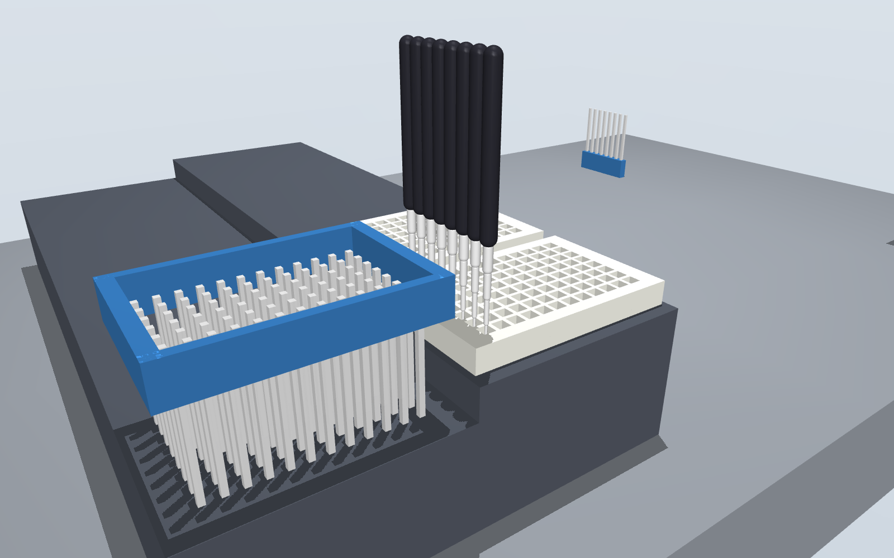

# drybench

Rehearse a lab-robot protocol in a physics scene before it touches a real bench.

drybench takes a protocol written for [PyLabRobot](https://github.com/PyLabRobot/pylabrobot),
builds a [MuJoCo](https://mujoco.org) scene from the same deck the protocol uses, replays every
pipetting move in it, and tells you what the channels and tips would run into.



**Status: pre-alpha (Phase 0).** It works for single-channel pipetting on any PyLabRobot deck.
It is not yet a tool to trust with a real run. See [What it does not do yet](#what-it-does-not-do-yet).

## Try it

```bash
pip install -e .
drybench demo
```

The demo is an 8-channel transfer on a Hamilton STARlet deck: pick up tips, take 100 uL from
column 1 of one plate, put it in column 1 of another, return the tips.

```
demo: the protocol as intended
drybench rehearsal: PASS
  steps rehearsed: 32 (path 6.79 m, 854 samples)
  collisions: 0
```

Now plant a mistake:

```bash
drybench demo --fault offset   # aspirate 4.5 mm off centre
drybench demo --fault depth    # aspirate 3 mm below the well floor
```

```
drybench rehearsal: FAIL
  collisions: 8
    - step 8 (aspirate, channel 0): the tip runs into source [source/wall_x#1] during descend, ...
```

The command exits with status 1 when anything collides, so it can gate a script or a CI job.
Each run writes `scene.xml` (open it with `python -m mujoco.viewer --mjcf drybench-out/scene.xml`),
`report.json`, `report.txt`, and two pictures when the machine can render offscreen.

## Use it on your own protocol

Swap your backend for `RecordingBackend`, run the protocol, then rehearse what it recorded.

```python
import asyncio
from pylabrobot.liquid_handling import LiquidHandler
from drybench import RecordingBackend, rehearse

async def main():
    deck = build_my_deck()                      # your usual PyLabRobot deck
    backend = RecordingBackend(num_channels=8)
    lh = LiquidHandler(backend=backend, deck=deck)
    await lh.setup()

    await my_protocol(lh)                       # unchanged

    result = rehearse(deck, backend.steps)
    print(result.report())
    if not result.ok:
        raise SystemExit(1)

asyncio.run(main())
```

To get only the scene, with no protocol: `drybench.export_scene(deck)` returns MuJoCo XML.

## How the scene is built

PyLabRobot describes a deck as a tree of resources, each with a position and a bounding box.
A bounding box is not a solid: a carrier's box reaches above the plates standing on it, and a
plate's box contains its wells. drybench keeps only what the tree lets it know is solid.

| Resource | Becomes |
| --- | --- |
| Nothing inside it (a lid, a gripper block) | A solid box |
| A grid of cavities (a plate, a tip rack) | A floor under the cavities, plus the walls between and around them |
| Anything else with children (a carrier, the deck) | Solid from its bottom up to the lowest thing inside it |
| A cavity (a well, a tube, a tip spot) | Empty space. Liquid and tips are drawn but never collide |

Heights follow the Hamilton STAR backend in PyLabRobot: a tip is picked up at its top minus its
fitting depth, and liquid is moved with the tip's end at the cavity floor plus the liquid height
the protocol gave.

## What it does not do yet

- **PyLabRobot 1.0.** drybench targets the 0.2 line, the current stable release. 1.0 is in beta
  and moves the liquid-handling classes.
- **Exact shapes.** Round wells are treated as square, tip-rack holes are not modelled, and a
  tip's width is a nominal cone because PyLabRobot stores tip length but not width.
- **The 96-channel head and plate moves.** These steps are listed as "not rehearsed" in the
  report instead of being silently skipped.
- **A changing deck.** The scene is the deck as it stood at the end of the run. Labware that
  moves during a run is not tracked.
- **A real robot's motion.** Channels go straight up, across at a fixed height and straight
  down. There is no timing estimate and no check against a particular robot's reach.
- **Fluid physics.** Volumes come from PyLabRobot's own trackers. Nothing here simulates how
  liquid flows.
- **Comparison with a real run.** Nothing has been checked against hardware yet.

## Where it is going

Phase 0 (this) is the bridge from a PyLabRobot deck to a physics scene. Next: a typed protocol
file, a planner, static checks on volumes and tips, and a `compile / check / rehearse / emit`
command line, so that a protocol written in plain language comes out as checked, rehearsed
PyLabRobot code.

## Development

```bash
pip install -e ".[dev]"
pytest
```

## License

Apache-2.0. See [LICENSE](LICENSE).
