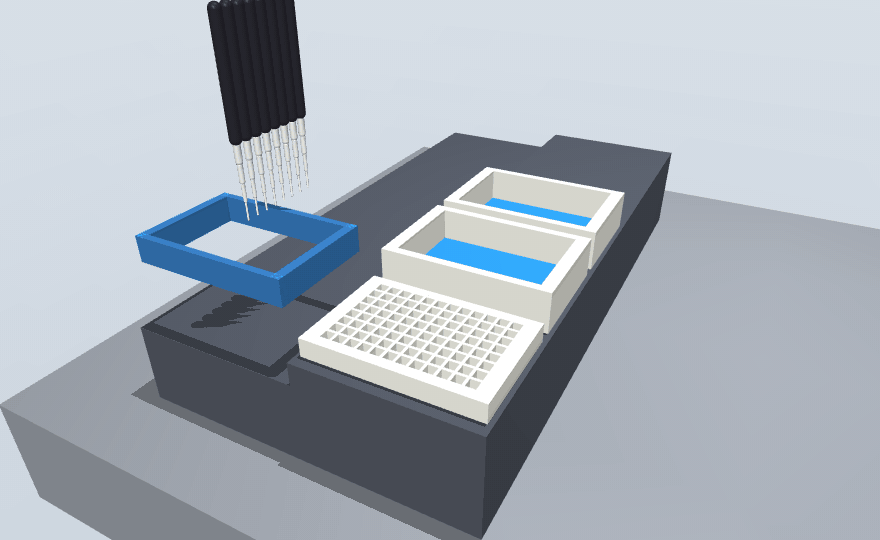
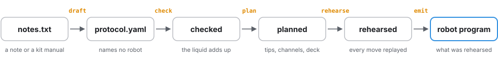
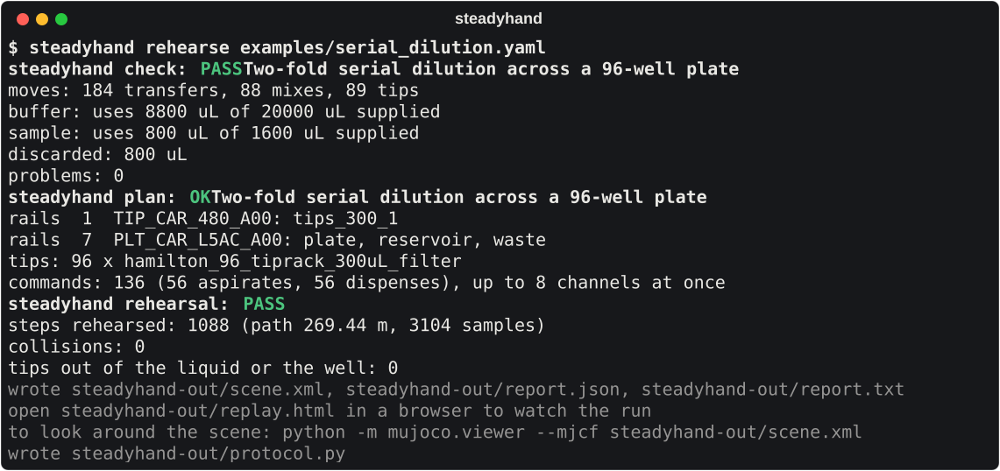
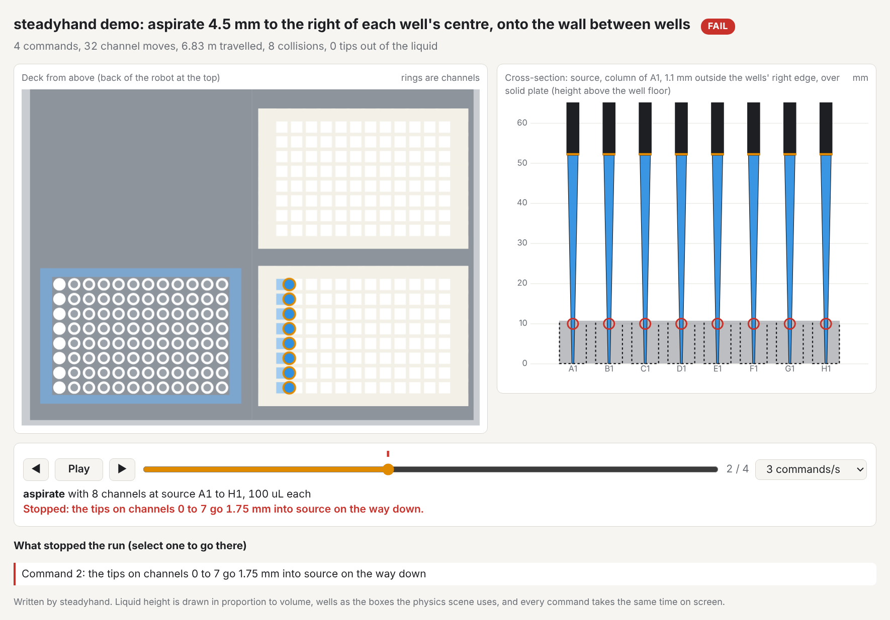

<p align="center">
  <picture>
    <source media="(prefers-color-scheme: dark)" srcset="docs/logo-dark.svg">
    
  </picture>
</p>

<p align="center">
  <b>Turn a written lab protocol into a robot program, and rehearse it before it touches a real bench.</b>
</p>

<p align="center">
  <a href="https://github.com/dundysm/steadyhand/actions/workflows/tests.yml"></a>
  <a href="https://pypi.org/project/steadyhand/"></a>
  <a href="https://pypi.org/project/steadyhand/"></a>
  <a href="LICENSE"></a>
  
</p>

<p align="center">
  
</p>

Write what you want done in a short protocol file that names no robot, or have a language model
draft that file from your notes or a kit manual. steadyhand checks that the liquid adds up, plans
the run for the robot you pick, replays every move in a [MuJoCo](https://mujoco.org) scene built
from the same deck, and writes the program that does exactly what was rehearsed.

<p align="center">
  <picture>
    <source media="(prefers-color-scheme: dark)" srcset="docs/pipeline-dark.svg">
    
  </picture>
</p>

> [!WARNING]
> **Pre-alpha.** The whole path runs for pipetting protocols on a Hamilton STARlet, an Opentrons
> Flex and an Opentrons OT-2, but nothing has been compared with a real robot yet. It is not a
> tool to trust with a real run. See [what it does not do yet](docs/limits.md).

| | Hamilton STARlet | Opentrons Flex | Opentrons OT-2 |
| --- | --- | --- | --- |
| Program it writes | [PyLabRobot](https://github.com/PyLabRobot/pylabrobot) script | Opentrons Python protocol | Opentrons Python protocol |
| Physics replay of every move | yes | yes | yes |
| The maker's own simulator | | yes | yes, a release that still takes OT-2 files |
| Magnet for bead cleanups | magnetic plate adapter | Magnetic Block | Magnetic Module |
| Planted mistakes stopped | [24 of 26](docs/faults.md) | [18 of 21](docs/faults-opentrons-flex.md) | [18 of 21](docs/faults-opentrons-ot2.md) |

## Try it

```bash
pip install steadyhand
steadyhand demo
```

`demo` rehearses a small protocol that ships inside the package. To run the examples in this
repository:

```bash
git clone https://github.com/dundysm/steadyhand && cd steadyhand
pip install -e .
steadyhand rehearse examples/serial_dilution.yaml
```

<p align="center">
  
</p>

`steadyhand-out/` then holds `protocol.py` (the PyLabRobot script), `replay.html` (the run played
back, below), `scene.xml` (open it with `python -m mujoco.viewer --mjcf steadyhand-out/scene.xml`),
a report as text and JSON, and two pictures when the machine can render offscreen. Every command exits with status 1 when
something is wrong, so it can gate a script or a CI job.

## The protocol file

The protocol in the run above is this file:

```yaml
steadyhand: 0.1
name: Two-fold serial dilution across a 96-well plate
labware:
  plate:     {type: Cor_96_wellplate_360ul_Fb}
  reservoir: {type: nest_1_troughplate_195000uL_Vb}
liquids:
  buffer: {in: reservoir/A1, volume: 20 mL}
  sample: {in: plate/A1:H1, volume: 200 uL}
steps:
  - transfer: {from: reservoir/A1, to: plate/A2:H12, volume: 100 uL, tips: reuse}
  - serial_dilution:
      start: plate/A1:H1
      steps: 11
      direction: right
      volume: 100 uL
      mix: {times: 3, volume: 80 uL}
```

It says what to do and nothing about how a robot does it. Every amount carries a unit, unknown
fields are errors, and every problem is reported at once with its place in the file. The format
is a draft: see [docs/protocol-format.md](docs/protocol-format.md).

## Draft it from your notes

```bash
steadyhand draft notes.txt --robot opentrons-flex -o protocol.yaml --decide "24 samples, in triplicate"
```

`draft` is the only place a language model is used. The model writes the protocol file; steadyhand
then checks, plans and rehearses that file exactly as if you had written it, and sends whatever
stops it back to the model, up to three times. The file lists what your text left open and the
model decided under `chose`, and `--decide` settles any of it up front. More in
[docs/drafting.md](docs/drafting.md).

## What it stops, measured

A dry run that passes says little unless you know what it would have failed on.

| Measured | Result |
| --- | --- |
| Known mistakes planted in a working protocol, and stopped | 24 of 26 on the Hamilton, 18 of 21 on the Flex and on the OT-2 |
| Drafts from manufacturers' kit manuals that stand as rehearsed programs with no hand edits | 104 of 126, from 61 manuals in eight sets |
| Automated tests | 200 |
| Runs compared with a real robot | none yet |

`steadyhand faults` runs the first row yourself; the tables are in [docs/faults.md](docs/faults.md)
and a test pins them, so a change in either direction shows. What gets through is named there
too: a tip carried down a dilution series, and a plate on the deck that is not the plate in the
plan. The drafting numbers, with every manual, every caveat and what the agents found unclear,
are in [evals/RESULTS.md](evals/RESULTS.md). The sets are small and were read by the project
itself, not by someone who runs these kits.

## Read more

| | |
| --- | --- |
| [The commands](docs/commands.md) | `check`, `plan`, `rehearse`, `emit`, `faults`: what each catches and decides, how to change the plan, and the replay page |
| [The protocol file](docs/protocol-format.md) | Every field: transfers, dilutions, mixes, waits, pauses, the magnet, `needs`, `chose` |
| [Robots](docs/robots.md) | What differs on the Flex and the OT-2, and what Opentrons' simulator adds |
| [Drafting from text](docs/drafting.md) | Using your own model, what the model is told, and how a draft is fed back |
| [Rehearsing a PyLabRobot script you already have](docs/pylabrobot.md) | The recording backend, and how the scene is built |
| [What it does not do yet](docs/limits.md) | Read this before relying on anything here |
| [Measurements](evals/RESULTS.md) | Every drafting run, newest first |

<p align="center">
  
</p>
<p align="center"><sub>Every rehearsal writes a single <code>replay.html</code> that plays the run back and opens at whatever stopped it.</sub></p>

## Development

```bash
pip install -e ".[dev]"
pytest
```

Earlier commits and notes call this project drybench; it was renamed at 0.14.0.

## License

Apache-2.0. See [LICENSE](LICENSE).
