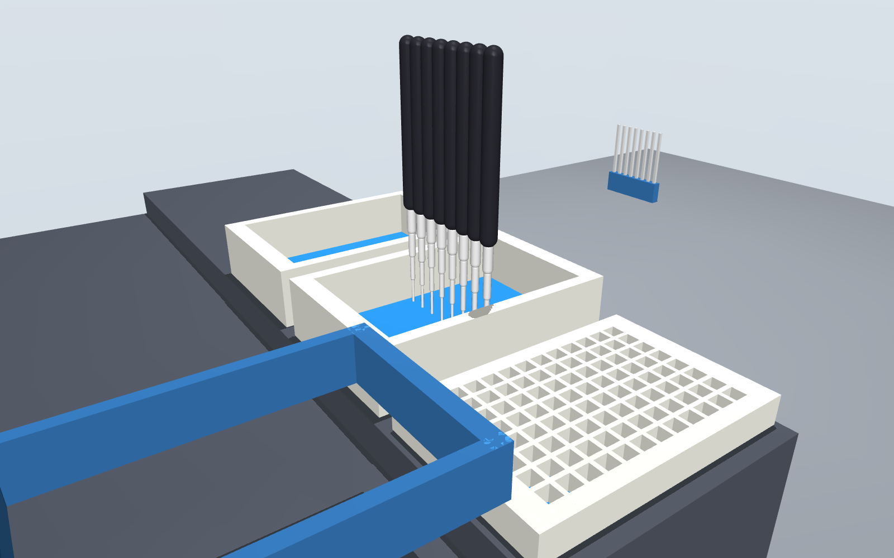
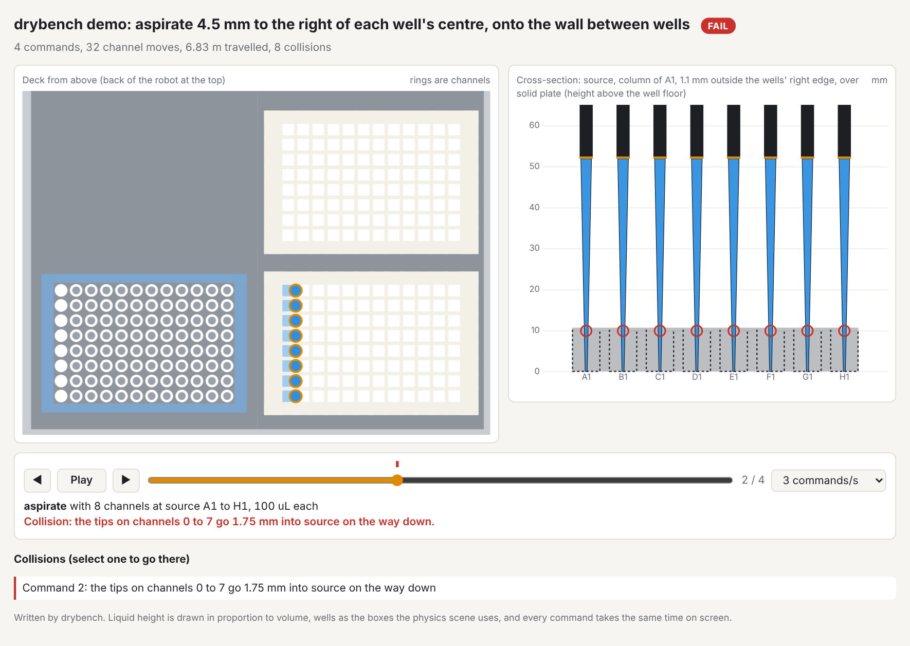

# drybench

Rehearse a lab-robot protocol in a physics scene before it touches a real bench.

Write what you want done in a short protocol file. drybench checks that the liquid adds up,
chooses tips, channels and a deck layout, replays every move in a [MuJoCo](https://mujoco.org)
scene built from the same deck, and writes a [PyLabRobot](https://github.com/PyLabRobot/pylabrobot)
script that does exactly what was rehearsed.



**Status: pre-alpha.** The whole path runs for pipetting protocols on a Hamilton STARlet deck.
Nothing has been compared with a real robot yet, so it is not a tool to trust with a real run.
See [What it does not do yet](#what-it-does-not-do-yet).

## Try it

```bash
pip install -e .
drybench rehearse examples/serial_dilution.yaml
```

```
drybench check: PASS  Two-fold serial dilution across a 96-well plate
  moves: 184 transfers, 88 mixes, 89 tips
  buffer: uses 8800 uL of 20000 uL supplied
  sample: uses 800 uL of 1600 uL supplied
  discarded: 800 uL
  problems: 0
drybench plan: OK  Two-fold serial dilution across a 96-well plate
  rails  1  TIP_CAR_480_A00: tips_300_1
  rails  7  PLT_CAR_L5AC_A00: plate, reservoir, waste
  tips: 96 x hamilton_96_tiprack_300uL_filter
  commands: 136 (56 aspirates, 56 dispenses), up to 8 channels at once
drybench rehearsal: PASS
  steps rehearsed: 1088 (path 269.44 m, 3104 samples)
  collisions: 0
  tips out of the liquid or the well: 0
wrote drybench-out/protocol.py
```

`drybench-out/` then holds `protocol.py` (the PyLabRobot script), `replay.html` (the run played
back, below), `scene.xml` (open it with `python -m mujoco.viewer --mjcf drybench-out/scene.xml`),
a report as text and JSON, and two pictures when the machine can render offscreen. Every command exits with status 1 when
something is wrong, so it can gate a script or a CI job.

## The protocol file

The protocol in the run above is this file:

```yaml
drybench: 0.1
name: Two-fold serial dilution across a 96-well plate
labware:
  plate:     {type: Cor_96_wellplate_360ul_Fb}
  reservoir: {type: nest_1_troughplate_195000uL_Vb}
liquids:
  buffer: {in: reservoir/A1, volume: 20 mL}
  sample: {in: plate/A1:H1, volume: 200 uL}
steps:
  - transfer: {from: reservoir/A1, to: plate/A2:H12, volume: 100 uL, tips: reuse}
  - serial_dilution:
      start: plate/A1:H1
      steps: 11
      direction: right
      volume: 100 uL
      mix: {times: 3, volume: 80 uL}
```

It says what to do and nothing about how a robot does it. Every amount carries a unit, unknown
fields are errors, and every problem is reported at once with its place in the file. The format
is a draft: see [docs/protocol-format.md](docs/protocol-format.md).

## The commands

| Command | What it does |
| --- | --- |
| `drybench draft NOTES -o FILE` | Has a language model write the protocol file from plain text. See below. |
| `drybench check FILE` | Reads the file and follows the liquid through every move. Add `--moves` to list them. |
| `drybench plan FILE` | Also chooses tips, groups moves into 8-channel commands and lays out the deck. |
| `drybench rehearse FILE` | Also replays the plan in the physics scene and, if nothing collides, writes the script. |
| `drybench emit FILE -o script.py` | Writes the PyLabRobot script without rehearsing. |
| `drybench faults` | Plants 24 known mistakes in a working protocol and lists which are stopped. |

### What `check` catches

- A well asked for more liquid than it holds at that point.
- A well filled past the capacity PyLabRobot gives for that labware.
- A volume too small to pipette.
- A sample too dilute to normalize, or a dilution series that runs off the plate.
- A declared liquid that no step touches, which usually means a step points at the wrong wells.

### What `plan` decides

- **Tips.** The smallest filter tip that holds the largest volume it will carry. A transfer bigger
  than the largest tip is split into equal parts.
- **Channels.** Consecutive moves share one 8-channel command when their wells sit in one column
  at least 9 mm apart, or all draw from one well wide enough to take them.
- **Deck.** Tip carriers from rail 1, plate carriers after them. Discarded liquid goes to a
  `waste` reservoir the planner adds, and to `waste_2` and so on as each fills.
- **Tip reloads.** If the run needs more tip racks than fit beside the plates, the plan keeps
  what fits and stops for a person to swap in full racks whenever a tip type runs out. The
  emitted script waits for Enter at each stop.

### Change what `plan` decided

Three of the planner's choices are yours to override: the tips, the deck layout and how far above
the well floor the tip stops. Write them to a file, edit it, and hand it back:

```
drybench plan examples/serial_dilution.yaml -o plan.yaml
drybench rehearse examples/serial_dilution.yaml --plan plan.yaml
```

```yaml
drybench_plan: "0.1"
pipetting_height: 1 mm
tips:                 # the planner takes the smallest that holds each volume
  - {type: hamilton_96_tiprack_300uL_filter, capacity: 300 uL}
  - {type: hamilton_96_tiprack_1000uL_filter, capacity: 1000 uL}
deck:                 # rails count from the left; a carrier is 6 rails wide
  - carrier: tip_carrier_1
    type: TIP_CAR_480_A00
    rails: 1
    sites: [tips_300_1, null, null, null, null]
  - carrier: plate_carrier_1
    type: PLT_CAR_L5AC_A00
    rails: 7
    sites: [plate, reservoir, waste, null, null]
```

`tips` takes any 96-tip rack PyLabRobot defines, with a capacity no larger than PyLabRobot says the
tip holds. Delete a section to have it chosen again; do that for `deck` after changing `tips`,
because the tip racks on it are named after the tips. The file is read as strictly as a protocol
file, and `plan`, `rehearse` and `emit` all take `--plan`. Which channels move together is not in
the file: that follows from where the wells are.

### Watch the run

`replay.html` is one file that needs no network, server or install: open it in a browser, or
attach it to a ticket. It shows the deck from above and a cross-section through the wells being
worked on, steps through every command with the liquid moving, and marks each collision where
it happened. Here a planted fault puts the tips over the wall between wells
(`drybench demo --fault offset`):



It draws the rehearsal's own data with two simplifications: liquid height is in proportion to
volume, and every command takes the same time on screen. It is 2D; for 3D open `scene.xml`.

### What `rehearse` checks

- **Collisions.** Whether a channel or its tip would be driven into the deck, a carrier, a
  plate's floor or the walls between wells, on the way across, down or up.
- **Channel spacing.** Whether a command asks two channels to sit closer than the head allows
  (9 mm on a STAR).
- **Tip in the liquid.** The liquid is followed through every step. An aspirate that starts with
  the tip above the liquid, or any aspirate or dispense with the tip above the rim of the well,
  fails the run. This is only trusted in flat-bottom wells, where the liquid height is known:
  in round- and V-bottom wells it is reported as possible and does not fail. An aspirate that
  ends with the liquid below the tip (emptying a well) is noted, not failed.

A test also confirms that PyLabRobot's own volume trackers end the run with the same volume in
every well that `check` predicted.

## What it stops, measured

A dry run that passes says little unless you know what it would have failed on. `drybench faults`
plants 24 specific mistakes in a short dilution that otherwise runs clean, and records the first
stage that stops each one. Today **22 of 24 are stopped**; the full table is in
[docs/faults.md](docs/faults.md), and a test pins it so a change in either direction shows.

The two that get through:

- The same tip is carried down each dilution series, so sample carries over. Nothing checks
  what a tip has touched.
- A 2 mL deep-well plate is on the deck where the plan expects the shallow plate. The wells line
  up and the tips reach the liquid, so nothing is hit; drybench cannot know the deck differs
  from the plan unless it is told.

The suite is one protocol on one deck, so it shows which kinds of mistake are stopped, not how
often.

## Draft a protocol from plain text

`draft` is the only place a language model is used. It writes the protocol file; drybench then
reads and checks that file exactly as if you had written it, and sends any problems back to the
model, up to three times. Nothing a model writes reaches a plan without passing `check`.

```bash
# any command that reads a prompt on stdin and prints a reply
drybench draft notes.txt -o protocol.yaml --model-command "my-local-model"

# or an API, with the key in ANTHROPIC_API_KEY or OPENAI_API_KEY
drybench draft notes.txt -o protocol.yaml --provider anthropic --model MODEL_NAME
drybench draft notes.txt -o protocol.yaml --provider openai --model MODEL_NAME
```

`--provider openai` works with any OpenAI-compatible server; point `OPENAI_BASE_URL` at it.
When the text leaves something out, the model is told to choose the conventional option and
record the choice under `notes` in the file. Read the file against your source before you use it.

To normalize samples to a common concentration, give it the readings as a CSV. The model is shown
the column names and the first few rows, so it can tell which column is which; the protocol it
writes names the file, and drybench reads the numbers from the file itself.

```bash
drybench draft notes.txt --samples readings.csv -o protocol.yaml --model-command "my-local-model"
```

The source can be a PDF, with `pip install drybench[pdf]`. Name the pages the protocol is on;
a whole manual is refused as too long.

```bash
drybench draft kit-manual.pdf --pages 4-6 -o protocol.yaml --model-command "my-local-model"
```

The text is taken as the PDF stores it, so tables come out as runs of words and a scanned page
has no text at all. This has been tested on small PDFs made for the tests, not yet on a
manufacturer's manual.

When the text asks for something that cannot work (more liquid than a named plate holds, a sample
too dilute to reach its target), the model is told to write it as stated and not to change your
numbers. `check` then refuses the file and says why, and the drafting stops there for you to decide.

## Rehearse a PyLabRobot protocol you already have

Swap your backend for `RecordingBackend`, run the protocol, then rehearse what it recorded.

```python
import asyncio
from pylabrobot.liquid_handling import LiquidHandler
from drybench import RecordingBackend, rehearse

async def main():
    deck = build_my_deck()                      # your usual PyLabRobot deck
    backend = RecordingBackend(num_channels=8)
    lh = LiquidHandler(backend=backend, deck=deck)
    await lh.setup()

    await my_protocol(lh)                       # unchanged

    result = rehearse(deck, backend.steps)
    print(result.report())

asyncio.run(main())
```

`drybench demo` runs a built-in example of this, and `drybench demo --fault offset` or
`--fault depth` plants a mistake to show a failing rehearsal.

## How the scene is built

PyLabRobot describes a deck as a tree of resources, each with a position and a bounding box.
A bounding box is not a solid: a carrier's box reaches above the plates standing on it, and a
plate's box contains its wells. drybench keeps only what the tree lets it know is solid.

| Resource | Becomes |
| --- | --- |
| Nothing inside it (a lid, a gripper block) | A solid box |
| A grid of cavities (a plate, a tip rack) | A floor under the cavities, plus the walls between and around them |
| Anything else with children (a carrier, the deck) | Solid from its bottom up to the lowest thing inside it |
| A cavity (a well, a tube, a tip spot) | Empty space. Liquid and tips are drawn but never collide |

Heights follow the Hamilton STAR backend in PyLabRobot: a tip is picked up at its top minus its
fitting depth, and liquid is moved with the tip's end at the cavity floor plus the liquid height.

## What it does not do yet

- **A proven intake.** `draft` has been measured only with Claude models, by agents playing the
  model one turn at a time. On the latest run, 28 of 31 notes (20 from public kit manuals) went
  from plain text to a rehearsed script at the first attempt with no hand edits, and the other
  three, which cannot work as written, were refused for the right reason. The runs, the notes
  and their sources are in [evals](evals/RESULTS.md). A pass means the file runs, not that it
  matches the note; two were read against their notes and matched. Drafting from a PDF is
  untested on real manuals.
- **A fully editable plan.** Tips, deck layout and pipetting height can be overridden for the
  whole run. Per-step heights, speeds and liquid classes cannot, and only the two carrier types
  the planner uses are accepted.
- **Washers, shakers, magnets and lids.** There is no plate washer, shaker, magnet or gripper:
  timed steps on them become waits, washes are done tip by tip, and a plate that ships with a
  lid is planned with the lid assumed off. When a run needs more tips than fit on the deck, the
  plan stops for a person to swap in full racks; nothing loads them automatically.
- **Adapters beyond one.** A PCR plate with no skirt is planned standing in PyLabRobot's
  MicroAmp 96-well base, and the plan says so. That is the only adapter the planner knows; four
  of PyLabRobot's plate definitions need it. Whether your plate really fits that base is yours
  to check.
- **Liquid behaviour.** The liquid-level check assumes the tip stays at one height (no liquid
  following or level detection) and knows the liquid height only in flat-bottom wells. Nothing
  models dead volume, viscosity, droplets or carry-over. The planner pipettes 1 mm above the
  floor everywhere, which is too high for a few microlitres in a flat-bottom well.
- **Other robots.** The planner targets a Hamilton STARlet. The rehearsal alone works on any
  PyLabRobot deck.
- **PyLabRobot 1.0.** drybench targets the 0.2 line, the current stable release.
- **Exact shapes.** Round wells are treated as square, tip-rack holes are not modelled, and a
  tip's width is a nominal cone because PyLabRobot stores tip length but not width.
- **The 96-channel head, plate moves and other instruments.** A rehearsal lists such steps as
  "not rehearsed" instead of skipping them silently.
- **A changing deck.** The scene is the deck as it stood at the end of the run.
- **A real robot's motion.** Channels go straight up, across at a fixed height and straight
  down. There is no timing estimate and no check against a particular robot's reach.
- **Fluid physics.** Volumes are accounting. Nothing here simulates how liquid flows.
- **Comparison with a real run.** Nothing has been checked against hardware yet.

## Development

```bash
pip install -e ".[dev]"
pytest
```

## License

Apache-2.0. See [LICENSE](LICENSE).
