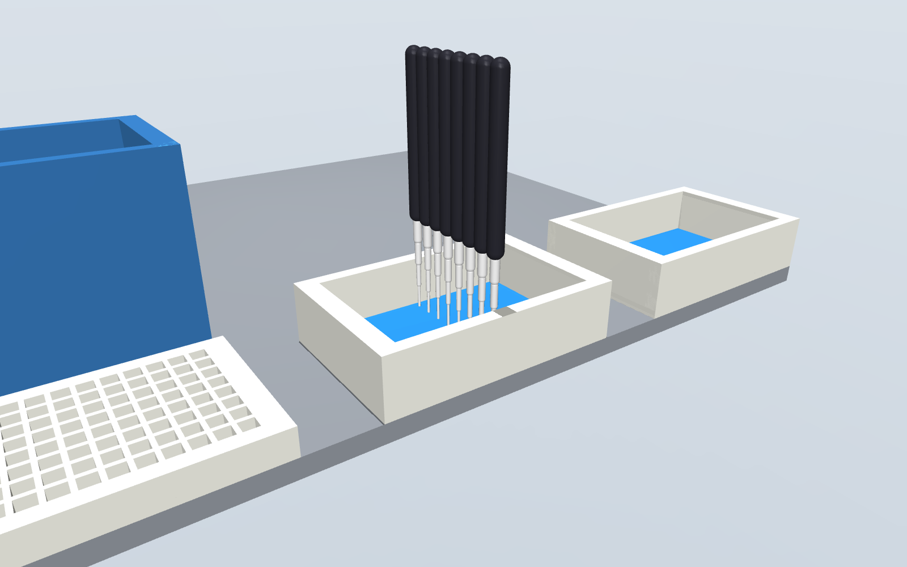

# steadyhand

[](https://github.com/dundysm/steadyhand/actions/workflows/tests.yml)
[](https://pypi.org/project/steadyhand/)

Turn a written lab protocol into a robot program, and rehearse it before it touches a real bench.

Earlier commits and notes call this project drybench; it was renamed at 0.14.0.

Write what you want done in a short protocol file that names no robot. steadyhand checks that the
liquid adds up, then plans it for the robot you pick: tips, pipettes or channels, and a deck
layout. It then replays every move in a [MuJoCo](https://mujoco.org) scene built from the same
deck, and writes the program that does exactly what was rehearsed: a
[PyLabRobot](https://github.com/PyLabRobot/pylabrobot) script for a Hamilton STARlet, or a
protocol for Opentrons' own Python API for a Flex or an OT-2, which is also run through
Opentrons' own simulator. See [Robots](#robots).


**Status: pre-alpha.** The whole path runs for pipetting protocols on a Hamilton STARlet, an
Opentrons Flex and an Opentrons OT-2. Nothing has been compared with a real robot yet, so it is
not a tool to trust with a real run.
See [What it does not do yet](#what-it-does-not-do-yet).

## Try it

```bash
pip install steadyhand
steadyhand demo
```

`demo` rehearses a small protocol that ships inside the package. To run the examples in this
repository:

```bash
git clone https://github.com/dundysm/steadyhand && cd steadyhand
pip install -e .
steadyhand rehearse examples/serial_dilution.yaml
```

```
steadyhand check: PASS  Two-fold serial dilution across a 96-well plate
  moves: 184 transfers, 88 mixes, 89 tips
  buffer: uses 8800 uL of 20000 uL supplied
  sample: uses 800 uL of 1600 uL supplied
  discarded: 800 uL
  problems: 0
steadyhand plan: OK  Two-fold serial dilution across a 96-well plate
  rails  1  TIP_CAR_480_A00: tips_300_1
  rails  7  PLT_CAR_L5AC_A00: plate, reservoir, waste
  tips: 96 x hamilton_96_tiprack_300uL_filter
  commands: 136 (56 aspirates, 56 dispenses), up to 8 channels at once
steadyhand rehearsal: PASS
  steps rehearsed: 1088 (path 269.44 m, 3104 samples)
  collisions: 0
  tips out of the liquid or the well: 0
wrote steadyhand-out/protocol.py
```

`steadyhand-out/` then holds `protocol.py` (the PyLabRobot script), `replay.html` (the run played
back, below), `scene.xml` (open it with `python -m mujoco.viewer --mjcf steadyhand-out/scene.xml`),
a report as text and JSON, and two pictures when the machine can render offscreen. Every command exits with status 1 when
something is wrong, so it can gate a script or a CI job.

## The protocol file

The protocol in the run above is this file:

```yaml
steadyhand: 0.1
name: Two-fold serial dilution across a 96-well plate
labware:
  plate:     {type: Cor_96_wellplate_360ul_Fb}
  reservoir: {type: nest_1_troughplate_195000uL_Vb}
liquids:
  buffer: {in: reservoir/A1, volume: 20 mL}
  sample: {in: plate/A1:H1, volume: 200 uL}
steps:
  - transfer: {from: reservoir/A1, to: plate/A2:H12, volume: 100 uL, tips: reuse}
  - serial_dilution:
      start: plate/A1:H1
      steps: 11
      direction: right
      volume: 100 uL
      mix: {times: 3, volume: 80 uL}
```

It says what to do and nothing about how a robot does it. Every amount carries a unit, unknown
fields are errors, and every problem is reported at once with its place in the file. The format
is a draft: see [docs/protocol-format.md](docs/protocol-format.md).

## The commands

| Command | What it does |
| --- | --- |
| `steadyhand draft NOTES -o FILE` | Has a language model write the protocol file from plain text, and rehearses what it wrote. See below. |
| `steadyhand check FILE` | Reads the file and follows the liquid through every move. Add `--moves` to list them. |
| `steadyhand plan FILE` | Also chooses tips, groups moves into 8-channel commands and lays out the deck. |
| `steadyhand rehearse FILE` | Also replays the plan in the physics scene and, if nothing collides, writes the script. |
| `steadyhand emit FILE -o script.py` | Writes the robot's program without rehearsing. |
| `steadyhand robots` | Lists the robots, and what `rehearse` checks on each. |
| `steadyhand faults` | Plants 26 known mistakes in a working protocol and lists which are stopped. |

`plan`, `rehearse` and `emit` take `--robot`. The rows above describe the Hamilton STARlet, which
is used when no robot is named; the others are under [Robots](#robots).

### What `check` catches

- A well asked for more liquid than it holds at that point.
- A well filled past the capacity PyLabRobot gives for that labware.
- A volume too small to pipette.
- A sample too dilute to normalize, or a dilution series that runs off the plate.
- A declared liquid that no step touches, which usually means a step points at the wrong wells.
- A reused tip that goes back into the well it draws from after it has been in wells holding
  another liquid, carrying that with it. Liquids are told apart by the names they are declared
  under, so two samples under one name are not, and a tip carried down a dilution series is
  not counted.

### What `plan` decides

- **Tips.** The smallest filter tip that holds the largest volume it will carry. A transfer bigger
  than the largest tip is split into equal parts.
- **Channels.** Consecutive moves share one 8-channel command when their wells sit in one column
  at least 9 mm apart, or all draw from one well wide enough to take them.
- **Deck.** Tip carriers from rail 1, plate carriers after them. Discarded liquid goes to a
  `waste` reservoir the planner adds, and to `waste_2` and so on as each fills.
- **Tip reloads.** If the run needs more tip racks than fit beside the plates, the plan keeps
  what fits and stops for a person to swap in full racks whenever a tip type runs out. The
  emitted script waits for Enter at each stop.
- **Waits.** A `wait` step is a command in the plan, between the moves it separates. The script
  sleeps for it on a robot and skips it when it only prints what it would do.
- **Pauses.** A `pause` step stops the run for a person to do one thing by hand (spin the plate,
  freeze and thaw it, read it) and goes on when they say. The plan counts them. The wells are
  taken to hold afterwards what they held before.
- **Tips that reach.** The tip for each move is the smallest that holds the volume and reaches:
  a channel is wider than a deep-well plate's wells, so a 10 uL tip, 21.9 mm long below the
  channel, cannot get to the floor of a well 41 mm deep. There the plan takes the next tip that
  can and says so.
- **Where the tip draws.** Normally 1 mm above the floor of the well. A transfer marked
  `draw_from: surface` keeps the tip 1 mm under where the liquid stands once the draw is over,
  to take liquid off cells or a pellet. The planner works that height out from the volume in the
  well, on every robot, and refuses where the inside shape of the well is not known. In a
  shallow well it changes little: taking 50 uL from 120 uL in a 96-well plate lifts the tip
  from 1 mm to 1.17 mm. A transfer can also name its own height (`draw_from: 0.5 mm`), to take
  nearly all of a small volume or to stay off what has settled.

### Change what `plan` decided

Three of the planner's choices are yours to override: the tips, the deck layout and how far above
the well floor the tip stops. Write them to a file, edit it, and hand it back:

```
steadyhand plan examples/serial_dilution.yaml -o plan.yaml
steadyhand rehearse examples/serial_dilution.yaml --plan plan.yaml
```

```yaml
steadyhand_plan: "0.1"
pipetting_height: 1 mm
tips:                 # the planner takes the smallest that holds each volume
  - {type: hamilton_96_tiprack_300uL_filter, capacity: 300 uL}
  - {type: hamilton_96_tiprack_1000uL_filter, capacity: 1000 uL}
deck:                 # rails count from the left; a carrier is 6 rails wide
  - carrier: tip_carrier_1
    type: TIP_CAR_480_A00
    rails: 1
    sites: [tips_300_1, null, null, null, null]
  - carrier: plate_carrier_1
    type: PLT_CAR_L5AC_A00
    rails: 7
    sites: [plate, reservoir, waste, null, null]
```

`tips` takes any 96-tip rack PyLabRobot defines, with a capacity no larger than PyLabRobot says the
tip holds. Delete a section to have it chosen again; do that for `deck` after changing `tips`,
because the tip racks on it are named after the tips. The file is read as strictly as a protocol
file, and `plan`, `rehearse` and `emit` all take `--plan`. Which channels move together is not in
the file: that follows from where the wells are.

### Watch the run

`replay.html` is one file that needs no network, server or install: open it in a browser, or
attach it to a ticket. It shows the deck from above and a cross-section through the wells being
worked on, steps through every command with the liquid moving, and marks each collision where
it happened. Here a planted fault puts the tips over the wall between wells
(`steadyhand demo --fault offset`):


It draws the rehearsal's own data with two simplifications: liquid height is in proportion to
volume, and every command takes the same time on screen. It is 2D; for 3D open `scene.xml`.

### What `rehearse` checks

- **Collisions.** Whether a channel or its tip would be driven into the deck, a carrier, a
  plate's floor or the walls between wells, on the way across, down or up.
- **Channel spacing.** Whether a command asks two channels to sit closer than the head allows
  (9 mm on a STAR).
- **Tip in the liquid.** The liquid is followed through every step. An aspirate that starts with
  the tip above the liquid, or any aspirate or dispense with the tip above the rim of the well,
  fails the run. On a Hamilton deck this is trusted in flat-bottom wells, where the liquid
  height is known, and in the three plates and reservoirs Opentrons also ships, whose inside
  shape is taken from Opentrons' definition when the `opentrons` package is installed. In other
  round- and V-bottom wells it is reported as possible and does not fail.
  On an Opentrons deck the height comes from the inside shape of the well, which Opentrons'
  definitions give for 45 of the 46 plates and reservoirs offered, so it is trusted in every
  bottom shape. The volumes agree with Opentrons' own maths at 270 heights checked by a test.
  An aspirate that starts in the liquid and takes it below the tip draws air for the rest. When
  that liquid is delivered to a well, or mixed back, the run fails and the report says how many
  microlitres are air. When it is thrown away it is noted, not failed: the well is only left
  with a little in it.

A test also confirms that PyLabRobot's own volume trackers end the run with the same volume in
every well that `check` predicted.

## Robots

```
steadyhand rehearse examples/serial_dilution.yaml --robot opentrons-flex
```

| `--robot` | Driven through | `emit` writes | `rehearse` checks |
| --- | --- | --- | --- |
| `hamilton-starlet` (when none is named) | PyLabRobot | A PyLabRobot script | Everything under [What `rehearse` checks](#what-rehearse-checks) |
| `opentrons-flex` | Opentrons' Python API | An Opentrons protocol | The same physics replay, on a deck built from Opentrons' labware definitions, and Opentrons' own simulator |
| `opentrons-ot2` | Opentrons' Python API | An Opentrons protocol | The same; the simulator only where one still takes OT-2 files |



A file can also say `robot: opentrons-flex` at the top; `--robot` wins over it. `check` is the
same for every robot.

**What the Opentrons plan decides.** Up to two pipettes, one per mount: the pair that moves
every volume in the fewest draws, with filter tips. Eight moves that fill or empty one whole
column of an 8-row plate with the same volume become one move of an 8-channel pipette, from
another column or from one reservoir well; part of a column, unequal volumes and 384-well plates
stay with a single channel. On the 27 intake drafts that ran on these robots when this was
measured (0.15.0), that cut the commands from 17,986 to 4,686 on the Flex. A single pipette holds one tip, so single moves that
a protocol interleaves across tips are put back together tip by tip where no well can tell the
difference; where one could, the order is kept and a fresh tip is used. Volumes below what any pipette moves are refused, which Opentrons' simulator does not do.
Plates go in the first free slots, tip racks after them; waste reservoirs, tip reloads and waits
work as on the Hamilton.

**Labware.** A protocol file may name a plate or reservoir by its Opentrons load name
(`corning_96_wellplate_360ul_flat`) when Opentrons' software is installed. Three plates are known
to be the same product in both libraries, and a file that uses only those plans for all three
robots: the Corning 96-well 360 uL flat plate and the NEST 1-well 195 mL and 12-well 15 mL
reservoirs. A test compares every well position of each pair. Any other PyLabRobot plate is
refused for an Opentrons robot, by name.

**Simulating.** `pip install 'steadyhand[opentrons]'` brings Opentrons' software. Its simulator
does not load on Python 3.10, where one of its own dependencies refuses; steadyhand's tests run on
3.10, 3.12 and 3.13, and everything else here works on all three. Its current
releases simulate Flex protocols only: Opentrons moved the OT-2 to its own software line. To
simulate an OT-2 protocol, install `opentrons==9.0.0` in a separate environment and set
`STEADYHAND_OT2_SIMULATE` to its `opentrons_simulate`; without that, `rehearse` writes the protocol,
says nothing simulated it, and exits with status 1.

**The replay on an Opentrons deck.** Every well and tip position, well depth and shape, labware
height, tip length and how far a tip slides onto the pipette come from the labware definitions
Opentrons ships. The plan's actions are sent to PyLabRobot's trackers and replayed as on the
Hamilton, so `rehearse` writes the same `replay.html`, `scene.xml` and report. Not taken from
Opentrons: the pipette itself. A channel is the same nominal 8 mm barrel as on the Hamilton,
travel is straight up, across above everything on the deck and straight down, and the Flex's
trash bin is a box of its nominal height. A rehearsal passes only if the replay and Opentrons'
simulator both pass.

What this catches that nothing did before: one of the intake drafts puts 180 uL of master mix in
a 15 mL reservoir, for a note that says "enough for 10 reactions". That is a film under 1 mm
deep, below where the tips stop, and the replay fails it by name. `draft` sends that back to the
model with the volume the well needs, and the model's second file supplies 2.2 mL and says so
under `notes`. That runs, but it is far more master mix than ten reactions need: about 375 uL
would have done, and a narrower tube would need less still. Read the notes of a draft. On the
Hamilton the first draft passes, because the shape of that reservoir's floor is not known there.

**What is missing on the Opentrons robots.** An 8-channel pipette always takes all eight tips,
so half a column is done one well at a time. No modules or gripper. No plan file to edit.

**A tight deck.** Eleven slots hold less than a Hamilton deck. When a run does not fit, the plan
makes room in this order: a pair of pipettes that needs fewer kinds of tip; one size of tip per
pipette; fewer waste reservoirs, with a pause for a person to empty them; fewer tip racks, with
pauses to reload. The plan report counts every pause. A full ELISA drafted from a kit note fits
this way, at the price of 14 tip reloads and 3 waste stops on a Flex: it runs, but someone has to
stand by it.

**Drafting for them.** `steadyhand draft notes.txt --robot opentrons-flex -o protocol.yaml` offers
the model the 46 plates and reservoirs Opentrons ships that can stand in a slot on their own, and
has it write the `robot:` line. On the 31 intake notes, 28 go from text to a protocol that
passes the physics replay and Opentrons' simulator on both robots with no hand edits, all at
the first attempt. The other three cannot work as written and are refused at `check`. Details and caveats are in [evals](evals/RESULTS.md).

## What it stops, measured

A dry run that passes says little unless you know what it would have failed on. `steadyhand faults`
plants 26 specific mistakes in a short dilution that otherwise runs clean, and records the first
stage that stops each one. Today **24 of 26 are stopped**; the full table is in
[docs/faults.md](docs/faults.md), and a test pins it so a change in either direction shows.

The two that get through:

- The same tip is carried down each dilution series, so sample carries over. The check on what
  a tip carries back tells liquids apart by name, and every well of a series holds the same
  ones; it does not weigh concentrations.
- A 2 mL deep-well plate is on the deck where the plan expects the shallow plate. The wells line
  up and the tips reach the liquid, so nothing is hit; steadyhand cannot know the deck differs
  from the plan unless it is told.

The same suite, with the mistakes that make sense there, runs on the Opentrons robots with
`steadyhand faults --robot opentrons-flex`: **18 of 21 are stopped** on both the
[Flex](docs/faults-opentrons-flex.md) and the [OT-2](docs/faults-opentrons-ot2.md). The three
that get through are the same tip carry-over, and a deep-well or a PCR plate standing where the
flat plate was planned: the wells line up and the tips fit inside them.

Each suite is one protocol on one deck, so it shows which kinds of mistake are stopped, not how
often.

## Draft a protocol from plain text

`draft` is the only place a language model is used. It writes the protocol file; steadyhand then
reads and checks that file exactly as if you had written it, plans it and rehearses it for the
robot, and sends whatever stops it back to the model, up to three times. A draft that passes
has been rehearsed. `--no-rehearse` stops at the check. The labware list the model is given
says, for every well whose inside shape is known, how much liquid a tip cannot reach, so it can
supply enough the first time.

```bash
# any command that reads a prompt on stdin and prints a reply
steadyhand draft notes.txt -o protocol.yaml --model-command "my-local-model"

# or an API, with the key in ANTHROPIC_API_KEY or OPENAI_API_KEY
steadyhand draft notes.txt -o protocol.yaml --provider anthropic --model MODEL_NAME
steadyhand draft notes.txt -o protocol.yaml --provider openai --model MODEL_NAME
```

`--provider openai` works with any OpenAI-compatible server; point `OPENAI_BASE_URL` at it.
When the text leaves something out, the model is told to choose the conventional option and
record the choice under `notes` in the file. Read the file against your source before you use it.

To normalize samples to a common concentration, give it the readings as a CSV. The model is shown
the column names and the first few rows, so it can tell which column is which; the protocol it
writes names the file, and steadyhand reads the numbers from the file itself.

```bash
steadyhand draft notes.txt --samples readings.csv -o protocol.yaml --model-command "my-local-model"
```

The source can be a PDF, with `pip install steadyhand[pdf]`. Name the pages the protocol is on;
a whole manual is refused as too long.

```bash
steadyhand draft kit-manual.pdf --pages 4-6 -o protocol.yaml --model-command "my-local-model"
```

The text is taken as the PDF stores it, so tables come out as runs of words and a scanned page
has no text at all. It has been run on the protocol pages of 13 manufacturers' manuals: see
[what it does not do yet](#what-it-does-not-do-yet) for how that went.

When the text asks for something that cannot work (more liquid than a named plate holds, a sample
too dilute to reach its target), the model is told to write it as stated and not to change your
numbers. `check` then refuses the file and says why, and the drafting stops there for you to decide.

## Rehearse a PyLabRobot protocol you already have

Swap your backend for `RecordingBackend`, run the protocol, then rehearse what it recorded.

```python
import asyncio
from pylabrobot.liquid_handling import LiquidHandler
from steadyhand import RecordingBackend, rehearse

async def main():
    deck = build_my_deck()                      # your usual PyLabRobot deck
    backend = RecordingBackend(num_channels=8)
    lh = LiquidHandler(backend=backend, deck=deck)
    await lh.setup()

    await my_protocol(lh)                       # unchanged

    result = rehearse(deck, backend.steps)
    print(result.report())

asyncio.run(main())
```

`steadyhand demo` runs a built-in example of this, and `steadyhand demo --fault offset` or
`--fault depth` plants a mistake to show a failing rehearsal.

## How the scene is built

PyLabRobot describes a deck as a tree of resources, each with a position and a bounding box.
A bounding box is not a solid: a carrier's box reaches above the plates standing on it, and a
plate's box contains its wells. steadyhand keeps only what the tree lets it know is solid.

| Resource | Becomes |
| --- | --- |
| Nothing inside it (a lid, a gripper block) | A solid box |
| A grid of cavities (a plate, a tip rack) | A floor under the cavities, plus the walls between and around them |
| Anything else with children (a carrier, the deck) | Solid from its bottom up to the lowest thing inside it |
| A cavity (a well, a tube, a tip spot) | Empty space. Liquid and tips are drawn but never collide |

Heights follow the Hamilton STAR backend in PyLabRobot: a tip is picked up at its top minus its
fitting depth, and liquid is moved with the tip's end at the cavity floor plus the liquid height.

## What it does not do yet

- **A proven intake.** `draft` has been measured only with Claude models, by agents playing the
  model one turn at a time. Two tests from outside, on the protocol pages of manufacturers'
  manuals read straight from the PDFs, each with the guide frozen beforehand: 14 protocols at
  0.26.1 and, after the fixes that run led to, 11 more at 0.27.0. Over both, 48 of 50 drafts
  reach a rehearsed program with no hand edits (Hamilton 24 of 25, Opentrons Flex 24 of 25),
  39 of them at the first attempt. That part holds up.
- **A draft you can run without reading it.** A pass means the file runs, not that it does what
  the manual asks, so the drafts were read against their pages. Most follow the pipetting. But
  in the second set every serious fault passed rehearsal: 1 h at 95 C, 18 h at 4 C and two days
  at 37 C written as waits on the deck; a bead cleanup with no magnet, where removing the
  supernatant would take the beads; three spin-plate kits cut down to their first step or two;
  chloroform in plastic plates. The checks see liquid and collisions, not temperature, magnets,
  filters or materials. Each draft says what it left out in its notes: read them. No manual says
  how many samples a run has, so every layout is the model's choice. The sets are small, were
  run once and were read by the project itself, not by someone who has run these kits. On the
  31 notes the guide was tuned on, 28 pass at the first attempt on both robots and three are
  refused for the right reason; that is a fit, not a test. All of it, with the manuals and the
  notes, is in [evals](evals/RESULTS.md).
- **A fully editable plan.** Tips, deck layout and pipetting height can be overridden for the
  whole run. Per-step heights, speeds and liquid classes cannot, and only the two carrier types
  the planner uses are accepted.
- **Washers, shakers, magnets and lids.** There is no plate washer, shaker, magnet or gripper:
  a timed step at room temperature becomes a wait, a step off the deck (heat, cold, a spin, a read) becomes
  a pause for a person, washes are done tip by tip, and a plate that ships with a
  lid is planned with the lid assumed off. When a run needs more tips than fit on the deck, the
  plan stops for a person to swap in full racks; nothing loads them automatically.
- **Beads, filters and solvents.** A bead cleanup needs a magnet under the plate while the
  liquid is taken off; a spin or filter plate needs a centrifuge or vacuum to drain it; some
  chemistry needs glass. None of that is here. A protocol file can say so under `needs`, and
  `check` then refuses it with that reason. `draft` is told to use it, so such a text comes
  back as "this cannot run here, because", not as a file that rehearses clean and loses the
  beads.
- **Adapters beyond one.** A PCR plate with no skirt is planned standing in PyLabRobot's
  MicroAmp 96-well base, and the plan says so. That is the only adapter the planner knows; four
  of PyLabRobot's plate definitions need it. Whether your plate really fits that base is yours
  to check.
- **Liquid behaviour.** The liquid-level check assumes the tip stays at one height (no liquid
  following or level detection) and knows the liquid height only in flat-bottom wells. Nothing
  models dead volume, viscosity, droplets or carry-over. The planner pipettes 1 mm above the
  floor everywhere, which is too high for a few microlitres in a flat-bottom well.
- **Other robots.** Three are planned for: a Hamilton STARlet, an Opentrons Flex and an OT-2,
  the last two with the gaps listed under [Robots](#robots). The physics rehearsal alone works
  on any PyLabRobot deck.
- **PyLabRobot 1.0.** steadyhand targets the 0.2 line, the current stable release.
- **Exact shapes.** Round wells are treated as square, tip-rack holes are not modelled, and a
  tip's width is a nominal cone because PyLabRobot stores tip length but not width.
- **The 96-channel head, plate moves and other instruments.** A rehearsal lists such steps as
  "not rehearsed" instead of skipping them silently.
- **A changing deck.** The scene is the deck as it stood at the end of the run.
- **A real robot's motion.** Channels go straight up, across at a fixed height and straight
  down. There is no timing estimate and no check against a particular robot's reach.
- **Fluid physics.** Volumes are accounting. Nothing here simulates how liquid flows.
- **Comparison with a real run.** Nothing has been checked against hardware yet.

## Development

```bash
pip install -e ".[dev]"
pytest
```

## License

Apache-2.0. See [LICENSE](LICENSE).
