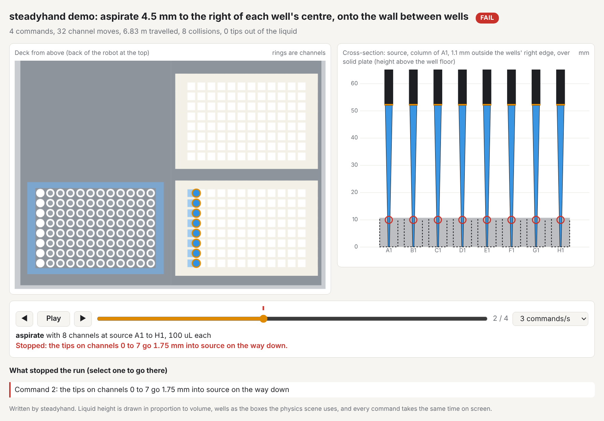

[steadyhand](../README.md) · [Commands](commands.md) · [Protocol file](protocol-format.md) · [Robots](robots.md) · [Drafting](drafting.md) · [PyLabRobot](pylabrobot.md) · [Limits](limits.md) · [Measurements](../evals/RESULTS.md)

# The commands

| Command | What it does |
| --- | --- |
| `steadyhand draft NOTES -o FILE` | Has a language model write the protocol file from plain text, and rehearses what it wrote. See [Drafting](drafting.md). |
| `steadyhand check FILE` | Reads the file and follows the liquid through every move. Add `--moves` to list them. |
| `steadyhand plan FILE` | Also chooses tips, groups moves into 8-channel commands and lays out the deck. |
| `steadyhand rehearse FILE` | Also replays the plan in the physics scene and, if nothing collides, writes the script. |
| `steadyhand emit FILE -o script.py` | Writes the robot's program without rehearsing. |
| `steadyhand robots` | Lists the robots, and what `rehearse` checks on each. |
| `steadyhand faults` | Plants 26 known mistakes in a working protocol and lists which are stopped. |

`plan`, `rehearse` and `emit` take `--robot`. The rows above describe the Hamilton STARlet, which
is used when no robot is named; the others are under [Robots](robots.md).

## What `check` catches

- A well asked for more liquid than it holds at that point.
- A well filled past the capacity PyLabRobot gives for that labware.
- A volume too small to pipette.
- A sample too dilute to normalize, or a dilution series that runs off the plate.
- A declared liquid that no step touches, which usually means a step points at the wrong wells.
- A reused tip that goes back into the well it draws from after it has been in wells holding
  another liquid, carrying that with it. Liquids are told apart by the names they are declared
  under, so two samples under one name are not, and a tip carried down a dilution series is
  not counted.

## What `plan` decides

- **Tips.** The smallest filter tip that holds the largest volume it will carry. A transfer bigger
  than the largest tip is split into equal parts.
- **Channels.** Consecutive moves share one 8-channel command when their wells sit in one column
  at least 9 mm apart, or all draw from one well wide enough to take them.
- **Deck.** Tip carriers from rail 1, plate carriers after them. Discarded liquid goes to a
  `waste` reservoir the planner adds, and to `waste_2` and so on as each fills.
- **Tip reloads.** If the run needs more tip racks than fit beside the plates, the plan keeps
  what fits and stops for a person to swap in full racks whenever a tip type runs out. The
  emitted script waits for Enter at each stop.
- **Waits.** A `wait` step is a command in the plan, between the moves it separates. The script
  sleeps for it on a robot and skips it when it only prints what it would do.
- **Pauses.** A `pause` step stops the run for a person to do one thing by hand (spin the plate,
  freeze and thaw it, read it) and goes on when they say. The plan counts them. The wells are
  taken to hold afterwards what they held before.
- **Tips that reach.** The tip for each move is the smallest that holds the volume and reaches:
  a channel is wider than a deep-well plate's wells, so a 10 uL tip, 21.9 mm long below the
  channel, cannot get to the floor of a well 41 mm deep. There the plan takes the next tip that
  can and says so.
- **Where the tip draws.** Normally 1 mm above the floor of the well. A transfer marked
  `draw_from: surface` keeps the tip 1 mm under where the liquid stands once the draw is over,
  to take liquid off cells or a pellet. The planner works that height out from the volume in the
  well, on every robot, and refuses where the inside shape of the well is not known. In a
  shallow well it changes little: taking 50 uL from 120 uL in a 96-well plate lifts the tip
  from 1 mm to 1.17 mm. A transfer can also name its own height (`draw_from: 0.5 mm`), to take
  nearly all of a small volume or to stay off what has settled.

## Change what `plan` decided

Three of the planner's choices are yours to override: the tips, the deck layout and how far above
the well floor the tip stops. Write them to a file, edit it, and hand it back:

```
steadyhand plan examples/serial_dilution.yaml -o plan.yaml
steadyhand rehearse examples/serial_dilution.yaml --plan plan.yaml
```

```yaml
steadyhand_plan: "0.1"
pipetting_height: 1 mm
tips:                 # the planner takes the smallest that holds each volume
  - {type: hamilton_96_tiprack_300uL_filter, capacity: 300 uL}
  - {type: hamilton_96_tiprack_1000uL_filter, capacity: 1000 uL}
deck:                 # rails count from the left; a carrier is 6 rails wide
  - carrier: tip_carrier_1
    type: TIP_CAR_480_A00
    rails: 1
    sites: [tips_300_1, null, null, null, null]
  - carrier: plate_carrier_1
    type: PLT_CAR_L5AC_A00
    rails: 7
    sites: [plate, reservoir, waste, null, null]
```

`tips` takes any 96-tip rack PyLabRobot defines, with a capacity no larger than PyLabRobot says the
tip holds. Delete a section to have it chosen again; do that for `deck` after changing `tips`,
because the tip racks on it are named after the tips. The file is read as strictly as a protocol
file, and `plan`, `rehearse` and `emit` all take `--plan`. Which channels move together is not in
the file: that follows from where the wells are.

## Watch the run

`replay.html` is one file that needs no network, server or install: open it in a browser, or
attach it to a ticket. It shows the deck from above and a cross-section through the wells being
worked on, steps through every command with the liquid moving, and marks each collision where
it happened. Here a planted fault puts the tips over the wall between wells
(`steadyhand demo --fault offset`):



It draws the rehearsal's own data with two simplifications: liquid height is in proportion to
volume, and every command takes the same time on screen. It is 2D; for 3D open `scene.xml`.

## What `rehearse` checks

- **Collisions.** Whether a channel or its tip would be driven into the deck, a carrier, a
  plate's floor or the walls between wells, on the way across, down or up.
- **Channel spacing.** Whether a command asks two channels to sit closer than the head allows
  (9 mm on a STAR).
- **Tip in the liquid.** The liquid is followed through every step. An aspirate that starts with
  the tip above the liquid, or any aspirate or dispense with the tip above the rim of the well,
  fails the run. On a Hamilton deck this is trusted in flat-bottom wells, where the liquid
  height is known, and in the seven plates and reservoirs Opentrons also ships, whose inside
  shape is taken from Opentrons' definition when the `opentrons` package is installed. In other
  round- and V-bottom wells it is reported as possible and does not fail.
  On an Opentrons deck the height comes from the inside shape of the well, which Opentrons'
  definitions give for 45 of the 46 plates and reservoirs offered, so it is trusted in every
  bottom shape. The volumes agree with Opentrons' own maths at 270 heights checked by a test.
  An aspirate that starts in the liquid and takes it below the tip draws air for the rest. When
  that liquid is delivered to a well, or mixed back, the run fails and the report says how many
  microlitres are air. When it is thrown away it is noted, not failed: the well is only left
  with a little in it.

A test also confirms that PyLabRobot's own volume trackers end the run with the same volume in
every well that `check` predicted.
