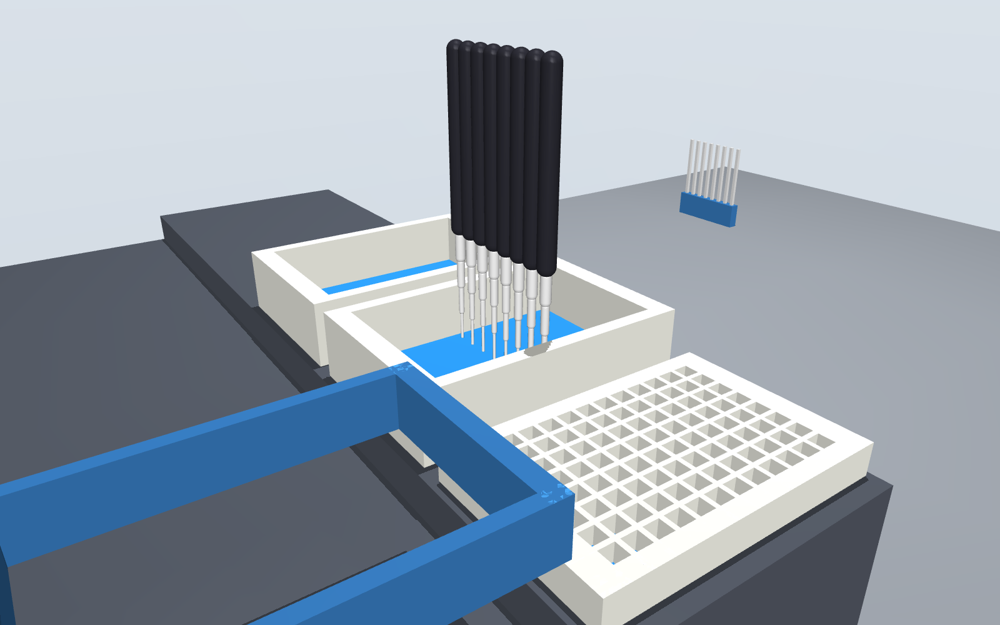

[steadyhand](../README.md) · [Commands](commands.md) · [Protocol file](protocol-format.md) · [Robots](robots.md) · [Drafting](drafting.md) · [PyLabRobot](pylabrobot.md) · [Limits](limits.md) · [Measurements](../evals/RESULTS.md)

# Rehearse a PyLabRobot protocol you already have

Swap your backend for `RecordingBackend`, run the protocol, then rehearse what it recorded.

```python
import asyncio
from pylabrobot.liquid_handling import LiquidHandler
from steadyhand import RecordingBackend, rehearse

async def main():
    deck = build_my_deck()                      # your usual PyLabRobot deck
    backend = RecordingBackend(num_channels=8)
    lh = LiquidHandler(backend=backend, deck=deck)
    await lh.setup()

    await my_protocol(lh)                       # unchanged

    result = rehearse(deck, backend.steps)
    print(result.report())

asyncio.run(main())
```

`steadyhand demo` runs a built-in example of this, and `steadyhand demo --fault offset` or
`--fault depth` plants a mistake to show a failing rehearsal.

## How the scene is built



PyLabRobot describes a deck as a tree of resources, each with a position and a bounding box.
A bounding box is not a solid: a carrier's box reaches above the plates standing on it, and a
plate's box contains its wells. steadyhand keeps only what the tree lets it know is solid.

| Resource | Becomes |
| --- | --- |
| Nothing inside it (a lid, a gripper block) | A solid box |
| A grid of cavities (a plate, a tip rack) | A floor under the cavities, plus the walls between and around them |
| Anything else with children (a carrier, the deck) | Solid from its bottom up to the lowest thing inside it |
| A cavity (a well, a tube, a tip spot) | Empty space. Liquid and tips are drawn but never collide |

Heights follow the Hamilton STAR backend in PyLabRobot: a tip is picked up at its top minus its
fitting depth, and liquid is moved with the tip's end at the cavity floor plus the liquid height.
