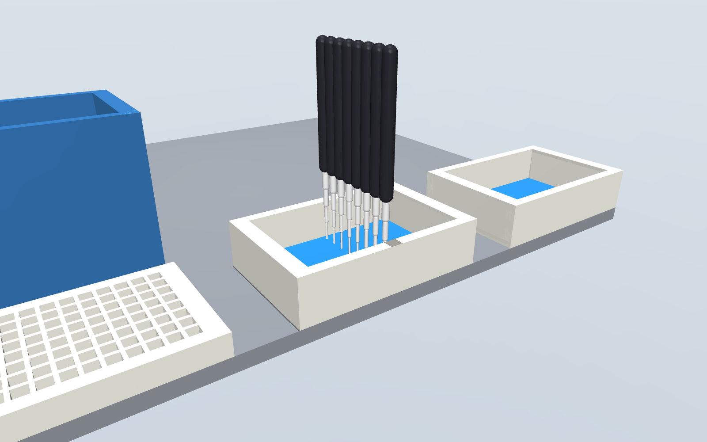

[steadyhand](../README.md) · [Commands](commands.md) · [Protocol file](protocol-format.md) · [Robots](robots.md) · [Drafting](drafting.md) · [PyLabRobot](pylabrobot.md) · [Limits](limits.md) · [Measurements](../evals/RESULTS.md)

# Robots

```
steadyhand rehearse examples/serial_dilution.yaml --robot opentrons-flex
```

| `--robot` | Driven through | `emit` writes | `rehearse` checks |
| --- | --- | --- | --- |
| `hamilton-starlet` (when none is named) | PyLabRobot | A PyLabRobot script | Everything under [What `rehearse` checks](commands.md#what-rehearse-checks) |
| `opentrons-flex` | Opentrons' Python API | An Opentrons protocol | The same physics replay, on a deck built from Opentrons' labware definitions, and Opentrons' own simulator |
| `opentrons-ot2` | Opentrons' Python API | An Opentrons protocol | The same; the simulator only where one still takes OT-2 files |



A file can also say `robot: opentrons-flex` at the top; `--robot` wins over it. `check` is the
same for every robot.

**What the Opentrons plan decides.** Up to two pipettes, one per mount: the pair that moves
every volume in the fewest draws, with filter tips. Eight moves that fill or empty one whole
column of an 8-row plate with the same volume become one move of an 8-channel pipette, from
another column or from one reservoir well; part of a column, unequal volumes and 384-well plates
stay with a single channel. On the 27 intake drafts that ran on these robots when this was
measured (0.15.0), that cut the commands from 17,986 to 4,686 on the Flex. A single pipette holds one tip, so single moves that
a protocol interleaves across tips are put back together tip by tip where no well can tell the
difference; where one could, the order is kept and a fresh tip is used. Volumes below what any pipette moves are refused, which Opentrons' simulator does not do.
Plates go in the first free slots, tip racks after them; waste reservoirs, tip reloads and waits
work as on the Hamilton.

**Labware.** A protocol file may name a plate or reservoir by its Opentrons load name
(`corning_96_wellplate_360ul_flat`) when Opentrons' software is installed. Seven are known
to be the same product in both libraries, and a file that uses only those plans for all three
robots: the Corning 96-well 360 uL flat plate, the Corning Costar 6-, 12-, 24- and 48-well plates,
and the NEST 1-well 195 mL and 12-well 15 mL reservoirs. A test compares every well position of
each pair. Plates with fewer than eight rows are worked one well at a time. Any other PyLabRobot plate is
refused for an Opentrons robot, by name.

**Simulating.** `pip install 'steadyhand[opentrons]'` brings Opentrons' software. Its simulator
does not load on Python 3.10, where one of its own dependencies refuses; steadyhand's tests run on
3.10, 3.12 and 3.13, and everything else here works on all three. Its current
releases simulate Flex protocols only: Opentrons moved the OT-2 to its own software line. To
simulate an OT-2 protocol, install `opentrons==9.0.0` in a separate environment and set
`STEADYHAND_OT2_SIMULATE` to its `opentrons_simulate`; without that, `rehearse` writes the protocol,
says nothing simulated it, and exits with status 1.

**The replay on an Opentrons deck.** Every well and tip position, well depth and shape, labware
height, tip length and how far a tip slides onto the pipette come from the labware definitions
Opentrons ships. The plan's actions are sent to PyLabRobot's trackers and replayed as on the
Hamilton, so `rehearse` writes the same `replay.html`, `scene.xml` and report. Not taken from
Opentrons: the pipette itself. A channel is the same nominal 8 mm barrel as on the Hamilton,
travel is straight up, across above everything on the deck and straight down, and the Flex's
trash bin is a box of its nominal height. A rehearsal passes only if the replay and Opentrons'
simulator both pass.

What this catches that nothing did before: one of the intake drafts puts 180 uL of master mix in
a 15 mL reservoir, for a note that says "enough for 10 reactions". That is a film under 1 mm
deep, below where the tips stop, and the replay fails it by name. `draft` sends that back to the
model with the volume the well needs, and the model's second file supplies 2.2 mL and says so
under `notes`. That runs, but it is far more master mix than ten reactions need: about 375 uL
would have done, and a narrower tube would need less still. Read the notes of a draft. On the
Hamilton the first draft passes, because the shape of that reservoir's floor is not known there.

**What is missing on the Opentrons robots.** An 8-channel pipette always takes all eight tips,
so half a column is done one well at a time. No modules or gripper. No plan file to edit.

**A tight deck.** Eleven slots hold less than a Hamilton deck. When a run does not fit, the plan
makes room in this order: a pair of pipettes that needs fewer kinds of tip; one size of tip per
pipette; fewer waste reservoirs, with a pause for a person to empty them; fewer tip racks, with
pauses to reload. The plan report counts every pause. A full ELISA drafted from a kit note fits
this way, at the price of 14 tip reloads and 3 waste stops on a Flex: it runs, but someone has to
stand by it.

**Drafting for them.** `steadyhand draft notes.txt --robot opentrons-flex -o protocol.yaml` offers
the model the 51 plates and reservoirs Opentrons ships that can stand in a slot on their own, and
has it write the `robot:` line. On the 31 intake notes, 28 go from text to a protocol that
passes the physics replay and Opentrons' simulator on the Flex with no hand edits, 27 of them at
the first attempt, and 26 of those also pass on the OT-2 with only the robot line changed. The
other three cannot work as written and are refused at `check`. Details and caveats are in [evals](../evals/RESULTS.md).
